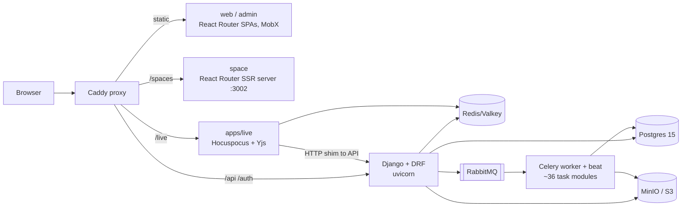
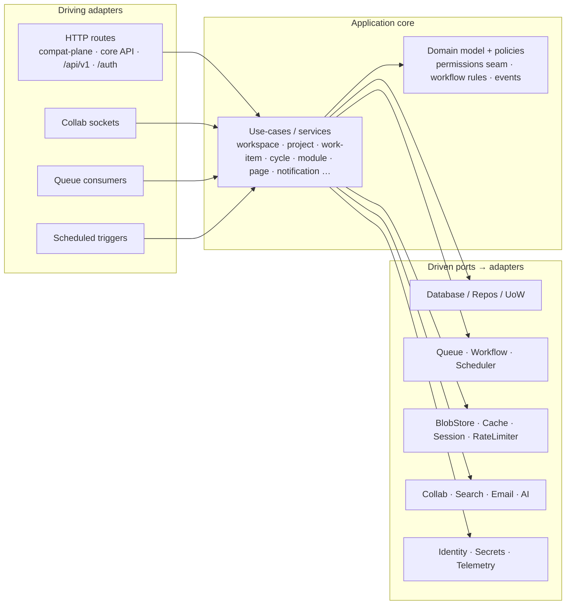
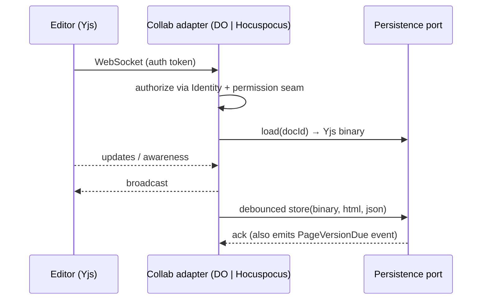

# ARCHITECTURE — Contrail

Status: **draft v0** (interview 2026-10-17). Boxes marked ⚠ are open (see QUESTIONS.md). Two views:
1. **Deployed architecture** — what runs where (Cloudflare set and self-hosted twin).
2. **Application architecture** — how the code is organised (hexagonal, ports & adapters).

## 0. Starting point (today's Plane, from repo survey)



Notable facts that constrain the design **[S]**: `Issue.save()` uses an advisory lock for `sequence_id`;
soft delete (`deleted_at`) is universal with partial unique constraints; collab persistence goes through the API
(binary + html + json written together); beat runs ~10 daily jobs and a 5-minute email digest; auth has
session cookies + `X-Api-Key`, no OIDC/SAML/SCIM in CE.

## 1. Deployed architecture

### 1a. Cloudflare adapter set (target)

> **Phasing (rounds 4–6):** the diagram is the end state. At P0 the **Durable Object collab** and **Workflows** boxes
> are absent (editing is a plain API save; exports/importers are P1), only DB/queue/blob have self-hosted twins, and
> adapter sets are compile-time bundles (ADR-0007). Auth starts as user+password, with Access then OIDC added.

```mermaid
flowchart TB
  U[Users / WARP] --> ACC[Cloudflare Access<br/>outer gate]
  M[Machine clients<br/>API keys] --> EDGE
  ACC --> EDGE[Workers edge]
  subgraph CF[Cloudflare account]
    EDGE --> STAT[Workers static assets<br/>web SPA and space SPA with Rust head injection, Q-0011.3]
    EDGE --> API[API Worker<br/>internal API + public /api/v1 + /auth]
    EDGE -->|WebSocket| COL[Durable Object: DocRoom<br/>Yjs]
    API --> DB[(DB: Hyperdrive via Workers VPC and Tunnel to CNPG Postgres in woven-o11y, ADR-0094)]
    API --> KV[(KV: cache · sessions)]
    API --> R2[(R2: assets · exports)]
    API --> Q[[Queues: events/outbox]]
    Q --> CONS[Consumer Worker<br/>notifications · webhooks · activity]
    API --> WF[Workflows<br/>exports · imports · long jobs]
    CRON[Cron Triggers] --> CONS
    COL --> R2
    COL --> DB
  end
  API --> IDP[Zitadel OIDC]
  CONS --> MAIL[Email: CF Email Service | SMTP]
```

Worker topology (⚠ ADR-0090): default hypothesis = one **API Worker** (Rust, workers-rs; router per ADR-0030), one **queue/cron consumer
Worker**, one **collab Worker** hosting the DO class, plus static assets bound to the edge Worker. Service bindings
between them; the API Worker never talks to the DO except via the collab port.

### 1b. Self-hosted twin (same application code, different adapters)

```mermaid
flowchart TB
  B[Browser] --> RP[Caddy / nginx]
  RP --> STAT[static files]
  RP --> API[API server<br/>native Rust (axum), same crates]
  RP --> COL[Hocuspocus server]
  API --> PG[(Postgres)]
  API --> VK[(Valkey)]
  API --> S3[(MinIO / S3)]
  API --> MQ[[RabbitMQ]]
  MQ --> WRK[Worker process<br/>queue consumers + workflow runner + scheduler]
  COL --> VK
  COL --> PG
```

### 1c. Adapter matrix (switch = config / compile-time + at most a redeploy)

| Port | Cloudflare adapter | Self-hosted adapter | ADR |
|---|---|---|---|
| `Database` | Hyperdrive→Workers VPC→Tunnel→CNPG Postgres (ADR-0094; engine still ⚠ pending spike 0002) | Postgres / SQLite ⚠ | 0040 |
| `Queue` | Cloudflare Queues | RabbitMQ | 0070 |
| `WorkflowEngine` | Cloudflare Workflows | ⚠ DB-backed runner / Temporal / Celery-compat | 0071 |
| `Scheduler` | Cron Triggers | in-process / cron scheduler | 0072 |
| `Collab` | Durable Objects + Yjs | Hocuspocus + Redis | 0060 |
| `BlobStore` | R2 | S3 / MinIO | 0080 |
| `Cache` / `SessionStore` / `RateLimiter` | KV (+ DO for strong counters) | Redis/Valkey | 0082, 0033 |
| `StaticHost` | Workers static assets | Caddy/nginx | 0011 |
| `Email` | CF Email Service / SMTP | SMTP | 0073 |
| `Search` | ⚠ D1/pg FTS · Vectorize · external | ⚠ Typesense/Meilisearch/OpenSearch | 0083 |
| `AI` | Workers AI / external | external | 0084 |
| `Identity` | OIDC (Zitadel) + Access JWT | OIDC | 0050 |
| `Secrets/Config` | Secrets Store / wrangler secrets | env / file / 1Password | 0092 |
| `Telemetry` | Workers Observability / OTel | OTel | 0130 |

## 2. Application architecture (hexagonal)

Rule: **domain and application code depend only on ports; no `worker::*` / workers-rs, `tokio-postgres`/`sqlx`, `lapin` or other platform
crate import outside an adapter crate.** An adapter set is chosen at composition time (ADR-0007).



### 2a. Package layout (Rust workspace in `aRustyDev/thrust`, ADR-0005/0006; redrawn round 25)

```
thrust/
  crates/
    thrust-ports/               # traits: Database/Repos/UoW, Queue, Workflow, Scheduler, BlobStore, Cache, Session,
                                #   RateLimiter, Collab, Search, Email, Ai, Identity, Secrets, Telemetry, Flags;
                                #   shared contract-test suites (ADR-0121)
    thrust-core/                # domain + use-cases; depends on ports only; Authorizer + `Scope` proof types (ADR-0051)
    thrust-contracts/           # event/outbox schemas, file-asset contract, API types (OpenAPI source, ADR-0032)
    thrust-api-core/            # axum: the new REST + OpenAPI core API (v1 clients, MCP, Dioxus later)
    thrust-api-v1/              # /api/v1 Plane wire-compat, a thin shim over core use-cases (ADR-0031)
    thrust-compat-plane/        # TRANSITIONAL: Plane-shaped internal endpoints for the React app (ADR-0034);
                                #   deleted when the Dioxus UI lands (ADR-0013 Phase 2)
    thrust-adapters-cloudflare/ # workers-rs: hyperdrive|d1, queues, kv, r2, cron, email, ai-gateway, rate limiting …
    thrust-adapters-selfhosted/ # postgres, rabbitmq, valkey, s3, smtp, in-process scheduler …
    thrust-worker/              # composition root: wasm32 Cloudflare Worker (cargo feature set `cloudflare`)
    thrust-server/              # composition root: native axum/tokio (cargo feature set `selfhosted`)
    thrust-collab-do/           # P1: the Durable Object classes. A DO must be exported from the same Wasm module as
                                #   `fetch`, so the collab Worker has its own root crate (spike 0001, ADR-0090)
  web/                          # pnpm workspace: adopted React apps (web, space) + @plane/* packages,
                                #   minimal changes only (ADR-0034); retired by ADR-0013 Phase 2
  docs/plan/                    # this planning package, once the repo is populated
```

Three HTTP surfaces sit on the same use-cases: **compat-plane** (React), **`/api/v1`** (wire-compatible with Plane) and the
**core API**. `apps/admin` is retired (ADR-0021), so two apps are served: `web` (a static SPA) and `space` (server-rendered in Plane, `ssr: true`; here an SPA plus Rust-injected metadata, Q-0011.3).

**Spike 0001 notes (round 26; crate names are those of the spike branch).** (1) Every port returns a `Send` future (ADR-0002); `Background`, `Clock` and `IdGen` are ports, so core never spawns or reads the clock. (2) One router crate (`thrust-api`) is compiled into both roots; `thrust-api-core`, `thrust-api-v1` and `thrust-compat-plane` are route groups composed into it. (3) The SQL lives once, in `thrust-adapters-postgres`, written at `tokio_postgres::Client` level behind a `Connector` (a native pool on the server, a Hyperdrive socket on the Worker); the cloudflare and selfhosted adapter crates supply the connector and the non-SQL adapters. (4) The one HTTP contract suite lives in `thrust-contract-tests` and runs against every target.

### 2b. Request flow (write path, any adapter set)

```mermaid
sequenceDiagram
  participant C as Client
  participant H as HTTP adapter
  participant U as Use-case
  participant D as Database port (UoW)
  participant O as Outbox / Queue port
  participant K as Consumers
  C->>H: POST /work-items
  H->>H: Identity + permission seam
  H->>U: createWorkItem(cmd)
  U->>D: tx{ allocate sequence_id; insert issue; insert outbox(event) }
  D-->>U: committed
  U-->>H: result
  H-->>C: 201
  O->>K: event WorkItemCreated (at-least-once)
  K->>K: activity row · notifications · webhooks · search index
```

Design commitments: transactional outbox (events written in the same transaction, relayed to `Queue`); consumers are
idempotent; the permission seam is called in the use-case layer (not the router) so every driving adapter is covered.

### 2c. Collab flow



## 3. Cross-cutting
- **Tenancy**: every aggregate carries a tenant key (`workspace_id`; instance-level for single-org); isolation
  mechanism per ADR-0041. No query without the tenant predicate (enforced in repository layer).
- **Contracts**: events (`contracts/events`), API schemas, and the file-asset lifecycle are versioned artifacts.
- **Config-driven adapters**: one typed `AppConfig` selects an adapter per port (ADR-0007); invalid combos fail at startup.
- **Observability**: trace-id propagated through Queue/Workflow/DO hops (ADR-0130).
- **Security**: SSRF guard on outbound URL fetches (link crawl, webhooks); API-key hashing; public-space data
  minimisation (ADR-0141).

## 4. Out of scope for this document
Implementation sequencing (next session), concrete schema, UI redesign.
